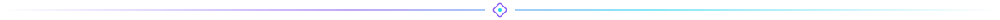

<!--
  Profile README for rakibul-islam-hasib
  Theme: violet #8B5CF6 → cyan #22D3EE on GitHub dark (#0D1117) / light (#FFFFFF)
  Everything in ./assets is generated, with all lettering drawn as vector paths:
  edit tools/build.mjs, then run `cd tools && npm install && npm run build`.
  The snake is generated by .github/workflows/snake.yml into the `output` branch.
-->

  
  
  

  

  

  <a href="https://github.com/rakibul-islam-hasib?tab=repositories">
    <picture>
      <source media="(prefers-color-scheme: light)" srcset="https://github-readme-stats.vercel.app/api?username=rakibul-islam-hasib&show_icons=true&rank_icon=github&card_width=495&custom_title=GitHub%20Overview&border_radius=12&bg_color=FFFFFF&border_color=D0D7DE&title_color=6D28D9&icon_color=0891B2&text_color=1F2328&ring_color=6D28D9&cache_seconds=21600" />
      
    </picture>
  </a>
  <a href="https://github.com/rakibul-islam-hasib">
    <picture>
      <source media="(prefers-color-scheme: light)" srcset="https://streak-stats.demolab.com?user=rakibul-islam-hasib&border_radius=12&background=FFFFFF&border=D0D7DE&stroke=D0D7DE&ring=6D28D9&fire=0891B2&currStreakNum=1F2328&sideNums=1F2328&currStreakLabel=6D28D9&sideLabels=57606A&dates=6E7781" />
      
    </picture>
  </a>

  <picture>
    <source media="(prefers-color-scheme: dark)" srcset="https://raw.githubusercontent.com/rakibul-islam-hasib/rakibul-islam-hasib/output/snake-dark.svg" />
    <source media="(prefers-color-scheme: light)" srcset="https://raw.githubusercontent.com/rakibul-islam-hasib/rakibul-islam-hasib/output/snake-light.svg" />
    
  </picture>

I’m always up for a good conversation about code, product ideas, or building something together. The fastest way to reach me is email.

  
  
  
  
  

 

  

